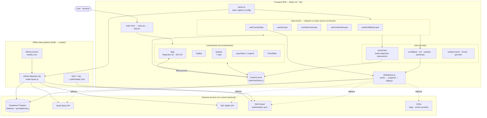

# Architecture

World Data Explorer is a single-page app with **no server of its own**:
Supabase (PostgreSQL) works as a **backend as a service**. The map and all
layers run in the browser, which reads from Supabase directly; public APIs are
the original sources, and an offline Node pipeline keeps the Supabase snapshots
fresh.

## How to read it

**Runtime (what happens in the browser)**

1. The user picks a layer or a country → the **Zustand store** (`activeLayer`,
   `selectedCountry`, …) updates. It is the single hub every component and hook
   reads from and writes to.
2. A **data hook** reacts and dispatches on the layer's `source` field
   (`worldbank` → `useWorldBankLayer`, `imf` → `useImfLayer`, a `historical`
   block → `useHistoricalLayer`, combine mode → `useCombinedLayer`). The layer
   registry in [`src/layers.js`](../src/layers.js) is the config that drives this.
3. The hook resolves data through [`src/lib/datasets.js`](../src/lib/datasets.js),
   whose resolution order is **in-memory cache → Supabase snapshot → live
   fallback** (original World Bank / IMF API or the self-hosted JSON). So the app
   still works, just slower, if a snapshot is missing.
4. [`colorScale`](../src/utils/colorScale.js) turns the data into a single
   MapLibre `['match', …]` fill expression, stored as `fillExpression`.
5. The **Map** applies that expression on the GPU. Hover/selection use
   imperative `setFeatureState`, so the map never re-renders through React.

**Offline pipeline (keeps the data fresh)**

- `scripts/fetch-*.mjs` regenerate the curated `public/data/*.json` files.
- [`scripts/refresh-datasets.mjs`](../scripts/refresh-datasets.mjs) derives the
  indicator list from `layers.js`, fetches every source, and upserts one row per
  dataset into the Supabase `datasets` table. A GitHub Actions cron runs it on a
  schedule, so adding a layer in `layers.js` is picked up automatically.

## Tech stack

| Area | Tech |
|---|---|
| UI | React 19 · Tailwind CSS 4 |
| Map | MapLibre GL JS 5 · react-map-gl |
| State | Zustand 5 |
| Data | Supabase · World Bank API · IMF SDMX API · static JSON pipeline |
| Tooling | Vite 8 · ESLint · Vitest · Vercel |
